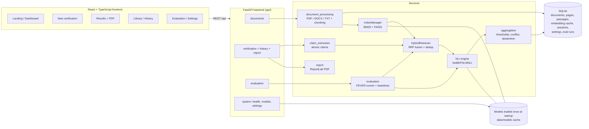
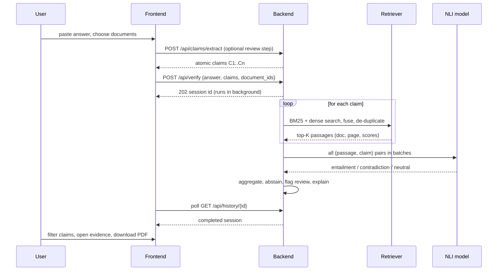

# TruthLens AI - Evidence-Grounded Verification of AI-Generated Answers

> **Don't just trust AI. Verify it.**

TruthLens AI takes an AI-generated answer, breaks it into individual factual claims, retrieves evidence for each claim from
**your own trusted documents** (PDF / DOCX / TXT), and decides with **Natural Language Inference (a DeBERTa MNLI model)** whether the
evidence *supports*, *contradicts*, or *does not settle* the claim. When evidence is weak, missing or conflicting it **abstains**
instead of guessing. Every verdict is traceable to a document, page and passage, and can be exported as a PDF report.

Everything runs locally with free, open-source models. **No API keys, no paid services.**

---

## Contents
1. [Features](#features) - 2. [Technology stack](#technology-stack) - 3. [Architecture](#architecture) - 4. [How a verdict is made](#how-a-verdict-is-made)
5. [Quick start (Windows)](#quick-start-windows) - 6. [Other platforms](#linux--macos) - 7. [Model setup](#model-setup) - 8. [Dataset setup (FEVER)](#dataset-setup-fever)
9. [Using the app](#using-the-app) - 10. [API](#api) - 11. [Testing](#testing) - 12. [What was and was not tested](#what-was-and-was-not-tested)
13. [Troubleshooting](#troubleshooting) - 14. [Limitations](#limitations) - 15. [Project layout](#project-layout)

## Features

| Area | What you get |
|---|---|
| **Answer input** | Large editor, multiple reference documents, drag-and-drop upload, one-click **Verify answer** |
| **Claim extraction** | Sentence splitting, atomic claims (compound sentences split, pronouns resolved), unique IDs, original sentence kept, **review / edit / add / delete claims before verifying** |
| **Document processing** | PDF (PyMuPDF), DOCX (python-docx, page breaks honoured), TXT; text cleaning; document name + page numbers preserved; overlapping sentence-aligned passages |
| **Hybrid retrieval** | BM25 (`rank-bm25`) + dense vectors (Sentence-Transformers + FAISS), weighted reciprocal-rank fusion, duplicate removal, per-passage BM25 / dense / fused scores shown |
| **NLI verification** | Premise = evidence, hypothesis = claim; entailment / contradiction / neutral probabilities; label order read from the model config |
| **Aggregation + abstention** | Configurable thresholds and margin, conflict detection (shows both sides, forces no verdict), human-review flags for low confidence / near misses |
| **Dashboard** | Totals, supported / contradicted / insufficient, claims needing review, overall summary, processing time, expandable claim cards, status filters |
| **Evidence library** | Document list with metadata, search, type filter, delete, passage preview, rebuild indexes (automatic on change) |
| **History** | Every session stored in SQLite with ID and timestamp; reopen, delete one or all |
| **PDF report** | Branded, with summary, original answer, claims, labels, NLI scores, evidence + page references, explanations, review warnings, limitations |
| **Evaluation** | FEVER subset evaluation of 4 systems with accuracy, macro-F1, precision, recall, confusion matrix, Evidence Recall@K / Precision@K, citation correctness, abstention coverage / error, timing; charts and tables |
| **UI** | Landing page, dashboard, 8 pages, light / dark mode, responsive + mobile drawer, toasts, loading, empty and error states, page transitions |

## Technology stack

* **Frontend:** React 18, TypeScript, Vite, Tailwind CSS, Framer Motion, Lucide React, Recharts, React Router
* **Backend:** Python, FastAPI, Uvicorn, Pydantic v2, SQLite
* **AI / ML:** Hugging Face Transformers (DeBERTa NLI cross-encoder), Sentence-Transformers, `rank-bm25`, FAISS, scikit-learn, NLTK (Porter stemmer only; optional spaCy hook)
* **Documents / reports:** PyMuPDF, python-docx, ReportLab
* **Defaults:** NLI `cross-encoder/nli-deberta-v3-base` (SNLI + MultiNLI), embeddings `sentence-transformers/all-MiniLM-L6-v2`. Both configurable in **Settings**.

## Architecture



### Verification workflow



## How a verdict is made

1. **Retrieval only finds candidates.** BM25 and dense scores are shown for transparency but are **never used as proof**.
2. Each retrieved passage is a *premise*, the claim is the *hypothesis*; the NLI model returns P(entailment), P(contradiction), P(neutral).
3. A passage **supports** if P(entailment) >= entail threshold (default 0.70) and it leads the other classes by the margin (0.10);
   it **contradicts** analogously.
4. Per claim: only supporting passages -> **SUPPORTED**; only contradicting -> **CONTRADICTED**; nothing decisive -> **INSUFFICIENT EVIDENCE**;
   **both** -> sources conflict: the claim is reported as insufficient, flagged for review, and both passages are displayed.
5. Verdicts below the review threshold (0.85), conflicts and near-misses are flagged **needs human review**.
6. The explanation text is generated from the real numbers (document, page, probabilities, thresholds).

## Quick start (Windows)

**Requirements:** Windows 10/11, **Python 3.10 - 3.12** (tick *Add python.exe to PATH*), about 5 GB free disk, internet for the first run.
Node.js is **not** required: the project ships with a pre-built interface.

1. Extract `TruthLens-AI-Complete.zip` (for example to `C:\TruthLens-AI`).
2. Double-click **`start.bat`**.
   * First run: creates `.venv`, installs dependencies (several minutes; PyTorch is large), then starts the server.
   * Your browser opens **http://localhost:8000**. Keep the black window open while you use the app.
3. Click **Get started -> New verification -> Load sample documents -> pick a sample answer -> Verify answer**.
   * The **first verification downloads the AI models once** (roughly 0.5 - 1 GB) into `data/models`. The top-right badge shows
     *Loading models...* then *Models ready*. To download in advance: `start.bat models`.

Other launcher modes: `start.bat dev` (hot reload, needs Node.js, UI on :5173), `start.bat test`, `start.bat setup`.

### Linux / macOS

```bash
./start.sh            # same as start.bat   (./start.sh dev | models | test | setup)
```

### Manual commands

```bash
python -m venv .venv && source .venv/bin/activate        # Windows: .venv\Scripts\activate
pip install -r backend/requirements.txt                  # smaller CPU-only PyTorch: pip install torch --index-url https://download.pytorch.org/whl/cpu
cd backend && python -m uvicorn app.main:get_app --factory --port 8000
# optional hot-reload frontend:
cd frontend && npm install && npm run dev                # http://localhost:5173 (proxies /api to :8000)
cd frontend && npm run build                             # rebuilds frontend/dist
```

## Model setup

Models are downloaded automatically on first use and cached in `data/models` (excluded from the ZIP). To pre-download:

```bash
python backend/scripts/download_models.py
python backend/scripts/download_models.py --nli cross-encoder/nli-deberta-v3-small   # lighter
```

* **Models load once** at server start (background thread). The UI shows their state; requests that need a model report a clear message while it is loading.
* **Download failure handling:** if the embedding model cannot be fetched, `auto` mode falls back to a TF-IDF + LSA dense retriever (clearly labelled, weaker).
  There is deliberately **no fallback for NLI**: verification stops with an explanatory error instead of producing fake verdicts.
* **Low-memory laptops:** choose *DeBERTa-v3 small / xsmall* in Settings and lower the NLI batch size. CPU inference is the default.
* Any Hugging Face NLI sequence-classification model with entailment / neutral / contradiction labels can be entered in Settings.

## Dataset setup (FEVER)

Evaluation needs FEVER, which is too large to ship. See [`evaluation/README.md`](evaluation/README.md).

```bash
python evaluation/download_fever.py --split paper_dev
python evaluation/run_fever_eval.py --sample-size 150            # or press "Run evaluation" in the app
```

Results appear on the **Evaluation** page. Use `--sample-size 60 --distractors 150` on limited hardware.

## Using the app

| Page | Purpose |
|---|---|
| `/` Landing | Product overview and animated workflow illustration |
| `/app` Dashboard | Totals, claim-distribution chart, recent verifications, quick start |
| `/app/verify` New verification | Paste answer, drag-and-drop documents, review claims, verify |
| `/app/results/:id` Results | Summary cards, filters, expandable claim cards with evidence, **Download PDF** |
| `/app/library` Evidence library | Documents, search, filters, delete, index status, rebuild |
| `/app/history` History | Reopen or delete past sessions |
| `/app/evaluation` Evaluation | Baseline comparison, F1 / precision / recall charts, confusion matrix, Recall@K, timing |
| `/app/settings` Settings | Models, thresholds, retrieval, top-K, claim extraction, theme |

**Sample data** (`data/samples`): `eiffel_tower_factsheet.txt`, `photosynthesis_overview.docx` (2 pages), `solar_system_notes.pdf` (2 pages) and
three sample answers (`sample_answers.json`) that each contain supported, contradicted and unsupported claims. Expected labels are what a careful human
would assign; the NLI model may disagree on individual claims, which is what the review flags are for. Regenerate with `python data/samples/build_samples.py`.

## API

Interactive docs: **http://localhost:8000/docs** (Swagger) and `/redoc`.

| Method & path | Description |
|---|---|
| `GET /api/health` | Liveness and model state |
| `GET /api/models/status`, `POST /api/models/reload` | Model / index status; reload models |
| `GET /api/settings`, `PUT /api/settings`, `POST /api/settings/reset` | Runtime settings (validated) |
| `POST /api/documents` | Upload one or more PDF / DOCX / TXT (multipart `files`); per-file results |
| `GET /api/documents?q=&ext=` | List / search / filter documents |
| `GET /api/documents/{id}`, `DELETE /api/documents/{id}` | Metadata + passage preview; delete (indexes rebuild) |
| `POST /api/documents/rebuild-index?wait=`, `GET /api/index/status` | Rebuild / inspect BM25 + FAISS indexes |
| `POST /api/claims/extract` | `{answer}` -> atomic claims |
| `POST /api/verify` | `{answer, claims?, document_ids?, wait?}` -> session (202, poll) or finished session (200 with `wait=true`) |
| `GET /api/history`, `GET /api/history/{id}`, `DELETE /api/history/{id}`, `DELETE /api/history` | Session history |
| `GET /api/history/{id}/report.pdf` | PDF report |
| `GET /api/stats/overview` | Dashboard aggregates |
| `GET /api/samples`, `POST /api/samples/load` | Sample documents and answers |
| `GET /api/evaluation/status`, `POST /api/evaluation/run`, `GET /api/evaluation/runs[/{id}]`, `GET /api/evaluation/results` | FEVER evaluation |

Errors are JSON `{"detail": "..."}` with 400 / 404 / 409 / 422 / 503 (model unavailable) as appropriate.

## Testing

```bash
cd backend && python -m pytest -q            # 84 tests (+1 opt-in real-model test)
RUN_MODEL_TESTS=1 python -m pytest -q tests/test_nli_and_aggregation.py   # also runs real DeBERTa inference (needs the model)
cd frontend && npm test                      # 12 component / page tests (vitest + Testing Library)
cd frontend && npm run build                 # type-check + production build
```

Backend tests cover document extraction (TXT/PDF/DOCX, page numbers, corrupt files, encodings), claim extraction, BM25, dense retrieval, RRF fusion, NLI label
mapping and failure handling, evidence aggregation, conflict and abstention, thresholds, API endpoints end to end, PDF generation, the FEVER loaders, hand-computed
metric checks, and the full evaluation runner.

## What was and was not tested

Be clear about this before demonstrating or reporting results.

**Tested (automated, in the build environment):** everything listed above, plus the complete UI flow in headless Chromium (sample load -> review claims -> verify ->
results -> filter -> expand evidence -> PDF download -> dark mode -> history delete), mobile layouts for horizontal overflow, and the production `uvicorn` startup command.

**Not tested in the build environment:** the build sandbox had no access to Hugging Face, so **the real DeBERTa NLI model and the Sentence-Transformers model were never
executed here.** Automated tests use a clearly labelled rule-based test double (`backend/tests/helpers.py`) only to exercise the surrounding logic, and TF-IDF/LSA for dense
retrieval. The real model code path (`app/services/nli.py`) is written against the Hugging Face API and has an opt-in test (`RUN_MODEL_TESTS=1`), but it must be run on your machine.
Likewise **no FEVER evaluation has been run**: the dataset was not available, so this project ships no benchmark numbers. The Evaluation page stays empty until you run it.
Expect your first real run to be the first time the full pipeline meets real model outputs; if a threshold feels off, adjust it in Settings.

## Troubleshooting

| Symptom | Fix |
|---|---|
| `Python was not found` | Install Python 3.10-3.12 from python.org and tick *Add to PATH*; reopen the window |
| `pip` fails on `faiss-cpu` / `torch` | Use Python 3.10-3.12 (not 3.13+ on older wheels), upgrade pip, retry `start.bat setup` |
| Badge says **Model problem** | Open Settings: the message shows the exact error. Usually no internet on first run. Fix and press **Reload models** |
| Badge says **Fallback retrieval** | The embedding model could not load; TF-IDF/LSA is used instead. Fix the download, press **Reload models** |
| Verification says *NLI model ... could not load* | Run `start.bat models` with internet access; or pick a smaller model in Settings |
| First verification is slow | Models are loading / warming up on CPU. Later runs are much faster; embeddings are cached in SQLite |
| Out of memory | Settings: smaller NLI model, NLI batch size 1-2, fewer passages sent to NLI |
| *Cannot reach the backend* banner | Start the server (`start.bat`) and keep its window open; port 8000 must be free |
| Port 8000 in use | Close the other program, or run uvicorn with `--port 8001` (and `VITE_API_URL` for dev mode) |
| Scanned PDF rejected | OCR is not supported; use a text-based PDF |
| Everything is "Insufficient evidence" | The selected documents may not cover the topic; check document selection, or lower thresholds slightly |
| Evaluation page shows setup steps | Download FEVER first (`evaluation/README.md`) |
| Reset everything | Stop the server and delete `data/truthlens.db`, `data/uploads/*` |

## Limitations

* **Verdicts are only as good as your documents.** *Insufficient evidence* means these documents say nothing decisive, not that the claim is false.
* **NLI models make mistakes** on negation, numbers, dates, long-range reasoning and implicit knowledge; probabilities are not guarantees. Review flagged claims.
* **Claim extraction is rule-based and heuristic** (no parser). Complex sentences, nested clauses and ellipsis ("Neptune is the farthest") can split imperfectly or lose context;
  that is why claims can be edited before verification. Pronoun resolution is limited to leading *It / This / They / He / She*.
* **Retrieval can miss evidence**; then the claim is reported as insufficient. Passages are 120 words by default; very long tables or figures are not interpreted.
* **No OCR**, no images, no spreadsheet or web sources. DOCX has no fixed pagination, so page numbers follow stored page breaks.
* English only with the default models.
* FEVER results use a closed subset corpus and are **not comparable to the FEVER leaderboard**; small subsets give noisy estimates.
* Single-user local app: no authentication; do not expose port 8000 to untrusted networks.
* Not legal, medical or financial advice and not suitable as the only check for safety-critical decisions.

## Project layout

```
TruthLens-AI/
|-- start.bat / start.sh         launchers (setup, run, dev, models, test)
|-- README.md  .gitignore
|-- backend/
|   |-- requirements.txt  requirements-dev.txt  pytest.ini
|   |-- app/
|   |   |-- main.py              FastAPI factory, CORS, error handlers, serves built UI
|   |   |-- config.py            paths + validated runtime settings
|   |   |-- database.py          SQLite layer
|   |   |-- schemas.py           request models
|   |   |-- api/                 documents, verification, system, evaluation routers
|   |   |-- services/            document_processing, claim_extraction, embeddings, retrieval, nli,
|   |   |                        aggregation, pipeline, managers (models/index/settings), library, report, text_utils
|   |   `-- evaluation/          fever loader, baselines, metrics, runner
|   |-- scripts/download_models.py
|   `-- tests/                   pytest suite
|-- frontend/                    React + TS + Vite + Tailwind (src/pages, src/components, src/lib, src/test), dist/ (pre-built)
|-- data/samples/                sample documents + sample answers (+ build_samples.py)
|-- evaluation/                  FEVER download + run scripts, README, results/, cache/
|-- reports/                     generated PDF copies
`-- docs/                        architecture and design notes
```
